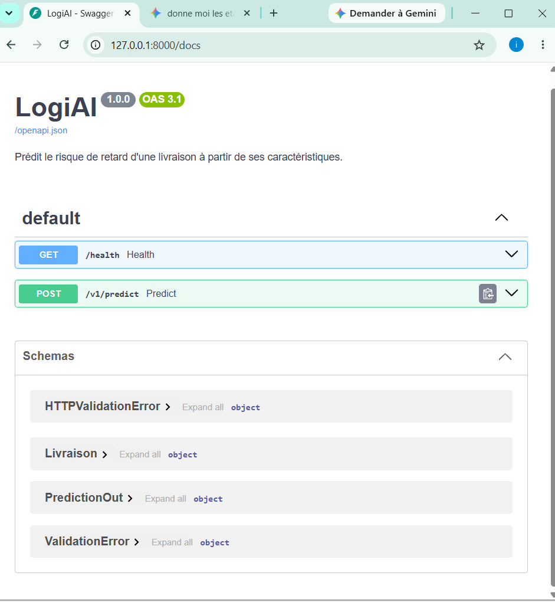
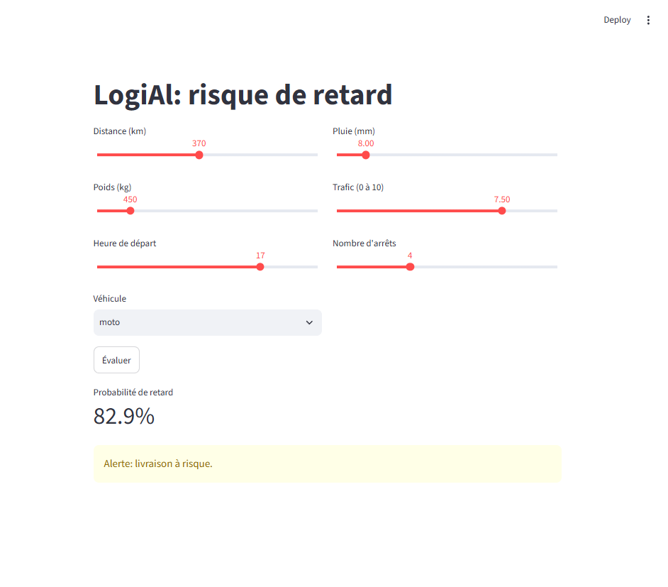
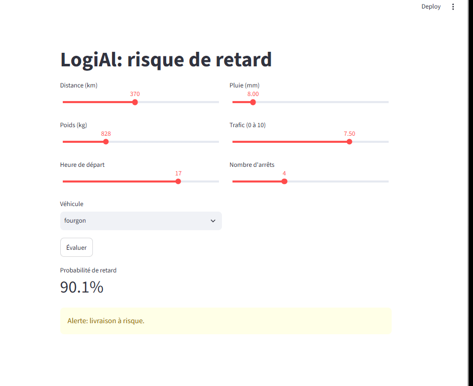
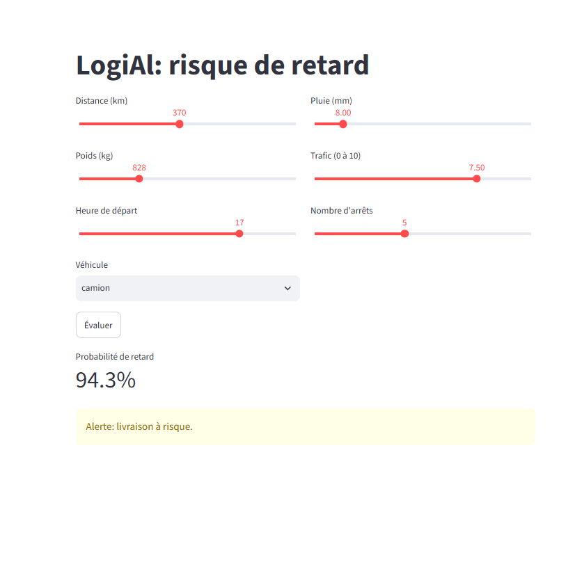

# LogiAI 🚚🤖 — Prédiction du risque de retard de livraison

**LogiAI** est un service complet de Machine Learning permettant de prédire le risque de retard de livraisons logistiques en fonction de divers facteurs (distance, météo, véhicule, trafic, etc.)[cite: 2, 21]. Le projet expose un modèle prédictif via une **API REST FastAPI** et propose une interface utilisateur interactive **Streamlit** pour les dispatchers[cite: 2, 16].

---

## 📌 Description du Projet

Dans le secteur du transport, anticiper les retards permet d'optimiser les tournées et de prévenir les clients à temps[cite: 2]. Ce projet transforme un modèle Machine Learning en un microservice disponible sur le réseau[cite: 2] :
- **Validation stricte** des données d'entrée via des schémas **Pydantic**[cite: 2, 9].
- **API REST** performante développée avec **FastAPI** et exécutée via **Uvicorn**[cite: 2, 9].
- **Interface web Streamlit** permettant d'évaluer une livraison en temps réel et de déclencher une alerte si la probabilité dépasse le seuil défini ($0.4$)[cite: 2, 3, 16].

---

## 📸 Aperçu de l'Application

### 1. Documentation OpenAPI (Swagger UI)
L'API REST est documentée et testable directement à l'adresse `/docs`[cite: 7, 11] :
[cite: 21]

### 2. Interface Streamlit — Simulations par type de véhicule
L'interface permet de tester différents scénarios logistiques en temps réel[cite: 16] :

| Simulation Moto | Simulation Fourgon | Simulation Camion |
| :---: | :---: | :---: |
| [cite: 24] | [cite: 22] | [cite: 23] |
| **82.9%** de risque[cite: 24] | **90.1%** de risque[cite: 22] | **94.3%** de risque[cite: 23] |

---

## 🏗️ Architecture du Projet

```text
logiai/
├── logiai/
│   ├── api/
│   │   ├── main.py        # Routes REST (/health, /v1/predict)[cite: 1, 7, 13]
│   │   └── schemas.py     # Schémas Pydantic de validation[cite: 1, 7, 12]
│   ├── config.py          # Configuration globale (seuils, chemins)[cite: 1, 12]
│   ├── dataset.py         # Génération du jeu de données[cite: 1, 12]
│   ├── train.py           # Entraînement et sauvegarde du modèle[cite: 1, 12]
│   └── predict.py         # Chargement du modèle et prédiction[cite: 1, 12]
├── data/                  # Jeu de données CSV[cite: 1, 6]
├── models/                # Modèle sauvegardé (.joblib)[cite: 6, 7]
├── tests/                 # Tests unitaires Pytest[cite: 1, 13]
├── streamlit_app.py       # Application client Streamlit[cite: 16]
├── COMPTE_RENDU.md        # Compte-rendu des travaux pratiques[cite: 1, 2]
└── requirements.txt       # Dépendances Python[cite: 1, 6]
